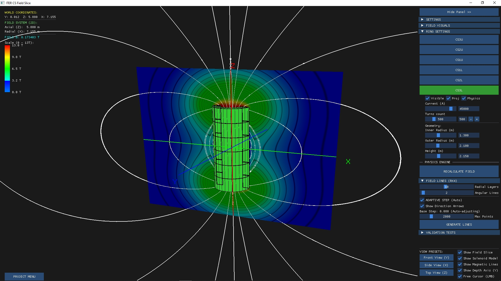

# ITER CS Field Slice — визуализация магнитного поля
Программа для расчёта и 3D-визуализации магнитного поля в сечении 
токамака ITER (Central Solenoid). Реализует численное интегрирование 
силовых линий методом Рунге-Кутты 4-го порядка (RK4) и интерактивное 
управление параметрами поля.

## Демонстрация


## Возможности
- Расчёт магнитного поля от токовых обмоток (катушек).
- Построение силовых линий методом RK4 с адаптивным шагом.
- Визуализация распределения поля в виде тепловой карты.
- 3D-отображение геометрии катушек и силовых линий.
- Интерактивное управление параметрами:
  - ток (Current, A)
  - количество витков (Turns count)
  - геометрия (внутренний/внешний радиус, высота)
- Переключение видов: Front, Side, Top.
- Валидация расчётов (Validation Tests).

## Технологии
- **C++17** — основной язык
- **OpenGL** — 3D-графика
- **GLFW** — окно и ввод
- **GLM** — математика (векторы, матрицы)
- **ImGui** — графический интерфейс
- **glad** — загрузчик OpenGL
- **CMake** — система сборки
- **Git** — контроль версий

## Математическая основа
- Закон Био — Савара — Лапласа для расчёта поля от катушек.
- Метод Рунге-Кутты 4-го порядка (RK4) для интегрирования силовых линий.
- Аналитическая геометрия для расчёта полей от соленоидов.
- Численные методы для работы с сетками и интерполяцией.

### Требования

- CMake 3.15+
- Visual Studio 2022 (или GCC/Clang)
- GLFW 3.4
- GLM 1.0.2
- OpenGL

### Команды

```bash
mkdir build
cd build
cmake .. -G "Visual Studio 17 2022" -A x64
cmake --build . --target gunner --config Release

### Pfgecr
build/Release/gunner.exe

### Структура проекта
main.cpp                  # точка входа
AppState.h                # состояние приложения
CentralSolenoid.cpp/.h    # геометрия и поле центрального соленоида
LineRenderer.cpp/.h       # отрисовка силовых линий
SliceRenderer.cpp/.h      # отрисовка среза поля
Shader.cpp/.h             # работа с шейдерами
UIManager.cpp/.h          # интерфейс ImGui
ProjectManager.cpp/.h     # управление проектом
Validation.cpp/.h         # валидация расчётов
camera.h                  # камера
physics.h                 # физические константы и формулы
imgui/                    # библиотека ImGui
libraries/                # GLFW, GLM, glad
CMakeLists.txt            # сборка

### Реализованно
Численное интегрирование силовых линий методом RK4.
Разделение физического ядра и графического интерфейса (ООП, SOLID).
Модульная архитектура: рендеринг, физика, UI — независимые модули.
Интерактивное управление параметрами в реальном времени.
Визуализация тепловых карт и силовых линий.

### Автор
Гайченко Максим Евгеньевич
НГТУ, ФПМИ, Прикладная математика и информатика
GitHub: @Maksusha186
Email: strahlderunke@gmail.com

### Лицензия
Учебный проект. Свободное использование.
